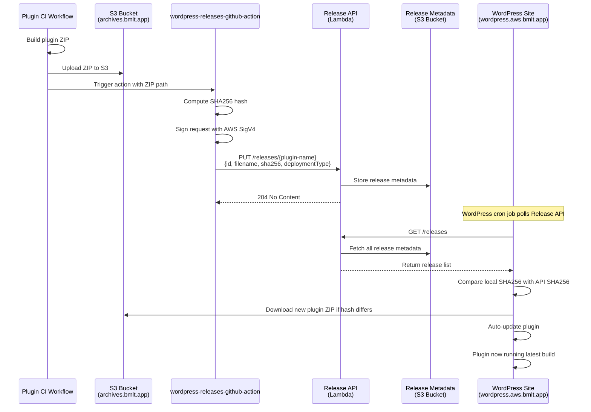

# wordpress-releases-github-action

This GitHub Action automatically publishes the latest WordPress plugin builds to the BMLT development WordPress site at [https://wordpress.aws.bmlt.app/](https://wordpress.aws.bmlt.app/).

## What It Does

When any BMLT WordPress plugin repository commits code, this action:

1. **Computes SHA256 hash** of the built plugin ZIP file
2. **Registers the release** with the BMLT Release API using AWS SigV4-authenticated PUT requests
3. **Triggers automatic deployment** to the test WordPress site
4. **Enables testing** of the latest development builds in a live WordPress environment

This allows developers to immediately test their changes on a real WordPress installation without manual deployment.

## How It Works



## Usage

In your plugin's CI workflow, add this step right after uploading artifacts to S3:

```yaml
      - name: Publish Release to Latest WP
        id: publish_latest
        uses: bmlt-enabled/wordpress-releases-github-action@v2
        with:
          file: ${{ env.DIST_DIR_S3 }}/${{ env.ZIP_FILENAME }}
          aws_account_id: ${{ secrets.AWS_ACCOUNT_ID }}
          s3_key: ${{ env.S3_KEY }}
```

### Inputs

- **`file`** (required): Path to the plugin ZIP file
- **`s3_key`** (required): Plugin identifier (e.g., `crouton`, `contacts-bmlt`)
- **`aws_account_id`** (required): AWS account ID for IAM role assumption
- **`deployment_type`** (optional): Deployment type, defaults to `wordpress`

### Outputs

- **`status_code`**: HTTP status code from the Release API (204 = success)
- **`put_data`**: JSON payload that was sent to the API

## Requirements

- Plugin ZIP must be uploaded to S3 before calling this action
- GitHub workflow must have `id-token: write` permission for OIDC authentication
- Plugin must be registered in the Release API's allowed plugins list

## Supported Plugins

The Release API currently supports these plugins:
- bmlt-tabbed-map
- bmlt-versions
- bmlt-wordpress-satellite-plugin
- bmlt-workflow
- bread
- contacts-bmlt
- crouton
- fetch-jft
- fetch-meditation
- fetch-spad
- hosted-jft
- list-locations-bmlt
- nacc-wordpress-plugin
- temporary-closures-bmlt
- upcoming-meetings-bmlt
- bmlt2calendar
- mayo-events-manager
- bmlt-enabled-stats

> **Note**: To add a new plugin, update the `WORDPRESS_PLUGINS` constant in [mvana-account-wide-tf/terraform/lambdas/release_api.py](https://github.com/mvascna/mvana-account-wide-tf/blob/main/terraform/lambdas/release_api.py#L8) and redeploy the Lambda function.
